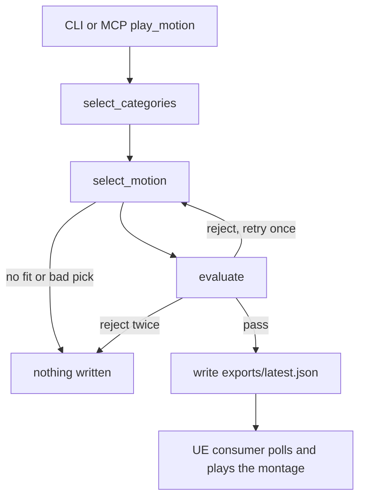

# realtime-ai-bridge

[](https://github.com/jcsilverio/realtime-ai-bridge/actions/workflows/ci.yml)

Type a request like "throw a quick jab" and an Unreal Engine 5 character plays it.
A LangGraph agent picks a clip from a catalog of 11 animations across five
categories (attack, react, emote, interact, and cast) and writes its choice to a JSON
file. The UE 5.4 project picks up that file and plays the matching montage. If
nothing in the catalog fits, nothing plays.

No API key? A keyword stub runs the same path for a few clips.

## How it works

Requests come from the command line or from an MCP client, and both go through
the same graph.



The agent picks in two steps. First it narrows the request to one or two
categories, then it chooses a clip from those, or says none fits. A separate call
checks that choice against the request. If it's rejected, the agent gets one more
try with that clip taken out. Python validates every answer along the way, so a
clip name the model made up never reaches Unreal.

On the Unreal side, a component on the character reads the file twice a second
and plays the montage whose name matches `clip_id`. Each `request_id` plays once,
and anything it doesn't recognize is ignored. Idle and locomotion stay on the
Animation Blueprint.

## Requirements

- Unreal Engine 5.4
- Python 3.14
- An OpenAI API key for the agent path. The keyword stub and the tests run without one.

Tested on Windows 11.

## Setup

```powershell
git clone https://github.com/jcsilverio/realtime-ai-bridge.git
cd realtime-ai-bridge
py -3.14 -m venv .venv
.\.venv\Scripts\python.exe -m pip install -r requirements.txt
Copy-Item .env.example .env
```

Put your key after `OPENAI_API_KEY=` in `.env`.

Open `unreal/RealtimeAIBridge/RealtimeAIBridge.uproject` in Unreal Engine 5.4.

The project is Blueprint only, so there's nothing to compile. The JSON Blueprint Utilities plugin is already enabled. The first open on a new machine compiles shaders and can take several minutes.

## Run

`ThirdPersonMap` opens by default. Press Play, then run from the repo root.

```powershell
.\.venv\Scripts\python.exe -m orchestrator.run "that's terrible news"
```

It prints the categories the agent chose, the evaluator's one-sentence reason,
and the `clip_id` and `request_id` it wrote to `exports/latest.json`. The
character plays that clip within about half a second, then blends back to idle.

Other requests to try:

- "throw a quick jab"
- "we won the championship!"
- "you look thirsty"
- "cast a fireball"
- "file my taxes" (no clip fits, so nothing is written and the command exits 2)

### Without an API key

```powershell
.\.venv\Scripts\python.exe scripts\smoke_stub.py "throw a quick jab"
```

Without an API key, the stub uses keyword matching only: "jab" or "punch" plays the jab,
"celebrate", "victory" or "cheer" plays the celebration, and "dance", "groove" or "boogie" plays the
dance.
Exits 1 when no keyword matches.

### Exit codes

| Code | Meaning |
|---|---|
| 0 | Export written |
| 1 | Error, such as a missing `OPENAI_API_KEY` or a failed API call |
| 2 | No catalog clip fits the request. Nothing written |
| 3 | The model picked a clip outside the candidates it was shown. Nothing written |
| 4 | The evaluator rejected the pick and the one retry. Nothing written |

## Tests

```powershell
.\.venv\Scripts\python.exe -m pytest -q
```

The tests use a scripted fake model, so no key is needed. CI runs them on
every push to `main` and on pull requests. Besides the graph tests, they check
that the catalog loads and follows its naming rule, and that every catalog clip
has its montage and sequence committed under `Content/IntegrationDemo/`. A clip
id with no matching asset fails the build instead of doing nothing in UE.

## Evaluation

`scripts/eval_selection.py` runs the 26 requests in `evals/selection_cases.jsonl`
through the real graph without writing an export. Six of them should play nothing.

```powershell
.\.venv\Scripts\python.exe scripts\eval_selection.py
```

The script needs an API key, so it runs locally and not in CI.

## Use from an MCP client

`mcp_server/server.py` runs the same graph as the CLI as an MCP server over stdio.

- `motion://catalog` is a resource with every clip, its category, and its description.
- `motion://contract` is a resource with the JSON schema of the export Unreal reads.
- `list_motions` is a tool that lists clips, optionally for one category.
- `play_motion` is a tool that runs a request through the selection graph. When
nothing fits or the evaluator rejects the pick, it returns the reason and writes
nothing.

To connect a client, point it at the venv's Python with the server script as its
argument. Most clients take a JSON entry like this one, though the file name and the
top-level key vary by client:

```json
{
  "mcpServers": {
    "realtime-ai-bridge": {
      "command": "C:\\path\\to\\realtime-ai-bridge\\.venv\\Scripts\\python.exe",
      "args": ["C:\\path\\to\\realtime-ai-bridge\\mcp_server\\server.py"]
    }
  }
}
```

The server reads the key from `.env` in the repo root, the same as the CLI. With PIE
running, ask the agent what the character can do, then ask for a move.

`tests/test_mcp_stdio.py` starts the server and calls it over stdio the same way a
client does, so the tests check the server without any client installed.

## Credits and license

- Code: MIT, see [LICENSE](LICENSE).
- Animation: [Quaternius Universal Animation Library](https://quaternius.com/packs/universalanimationlibrary.html) (CC0), retargeted to the UE5 mannequin under
`unreal/RealtimeAIBridge/Content/IntegrationDemo/`.
- Third Person template content and mannequin: Epic Games, under the Unreal
Engine EULA.
